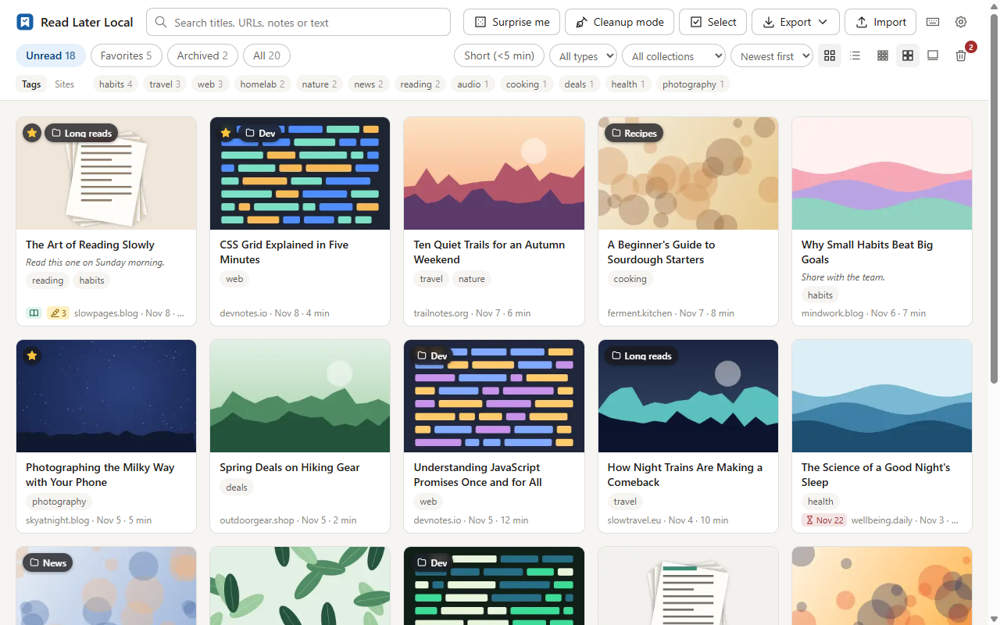

# Read Later Local

Extensión de Firefox para leer más tarde que guarda todo en tu ordenador: sin cuentas ni servidores.
Guarda páginas, léelas sin conexión, subraya, escúchalas y mantén tu lista bajo control con reglas de limpieza
automática. Una alternativa local a Pocket, con importación y exportación del CSV de Pocket.

[Read in English](README.md)



## Funciones

**Guardar**
- Con un clic en el icono de la barra de direcciones (`Alt+Shift+S`), desde el menú del botón o con clic derecho
  en cualquier enlace o página.
- Varias pestañas a la vez, o «Guardar y cerrar la pestaña».
- Guarda el texto del artículo (con Readability, de Mozilla), una miniatura y, si quieres, sus imágenes.
- Reconoce la misma página aunque cambie la dirección (parámetros de seguimiento, `www.`, anclas…).
- Importa la exportación de Pocket (CSV) con etiquetas y archivados; lo importado se completa en segundo plano.

**Leer**
- Lector sin conexión con tema claro, oscuro o sepia, tamaño de texto, fuente y ancho de columna.
- Recuerda por dónde ibas y puede archivar el artículo al llegar al final.
- Lectura en voz alta con las voces instaladas en el sistema.
- Subrayados en cuatro colores con notas; imprimir o guardar en PDF; enviar por correo; exportar a Markdown (Obsidian).
- Búsqueda dentro del texto de todos los artículos guardados.

**Organizar**
- Sin leer, favoritas, archivadas y papelera de 30 días.
- Etiquetas, colecciones, filtros por web y tipo, lecturas cortas y edición en grupo.
- Reglas automáticas (por ejemplo, `youtube.com` → etiqueta «vídeo»).
- Reglas de limpieza automática («lo de la colección Noticias con más de un mes», «lo archivado con más de un año»)
  y fecha de caducidad por entrada.
- Modo limpieza para repasar la lista entrada a entrada, y panel lateral (`Alt+Shift+B`).

**Tus datos**
- Copias automáticas en tu carpeta de Descargas; copia completa, CSV compatible con Pocket, marcadores HTML y Markdown.
- No recoge ni envía ningún dato. Solo se conecta a las páginas que guardas.
- 15 idiomas (incluido el árabe, de derecha a izquierda).

## Instalación

Desde Firefox Add-ons: <https://addons.mozilla.org/firefox/addon/read-later-local/>

Necesita Firefox 140 o posterior (escritorio).

## Permisos

| Permiso | Para qué |
|---|---|
| `activeTab`, `scripting` | Leer el artículo de la pestaña que guardas, solo cuando lo pides. |
| `tabs` | Indicar en la barra de direcciones si la página ya está guardada; guardar varias pestañas. |
| `menus` | Opciones del clic derecho. |
| `storage`, `unlimitedStorage` | Artículos, miniaturas e imágenes sin conexión guardados en local. |
| `downloads` | Copias de seguridad y exportaciones a tu disco. |
| `<all_urls>` (opcional) | Solo si activas la descarga en segundo plano de importados o las imágenes sin conexión. Se puede retirar en cualquier momento. |

## Desarrollo

```bash
npm install
npm test        # tests unitarios (node:test, fake-indexeddb, linkedom)
npm run lint    # web-ext lint
npm start       # abre Firefox con la extensión (web-ext run)
npm run build   # crea dist/read_later_local-<versión>.zip
```

La vista previa en un navegador normal, la estructura del proyecto y las herramientas de `dev/` se explican
en el [README en inglés](README.md#development).

## Licencia

[Mozilla Public License 2.0](LICENSE). `src/vendor/Readability.js` es © Mozilla, con licencia Apache 2.0
(ver `src/vendor/Readability-LICENSE.md`).
