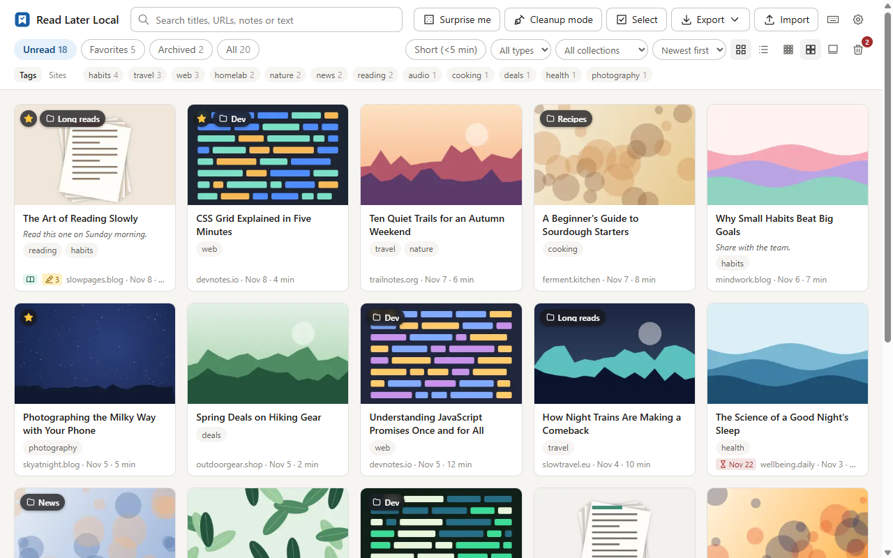
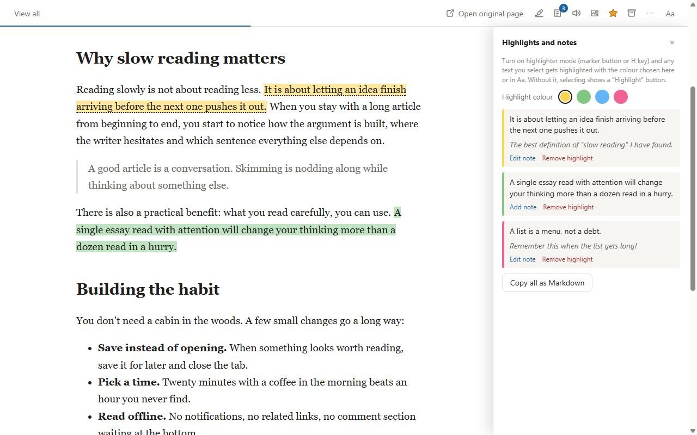
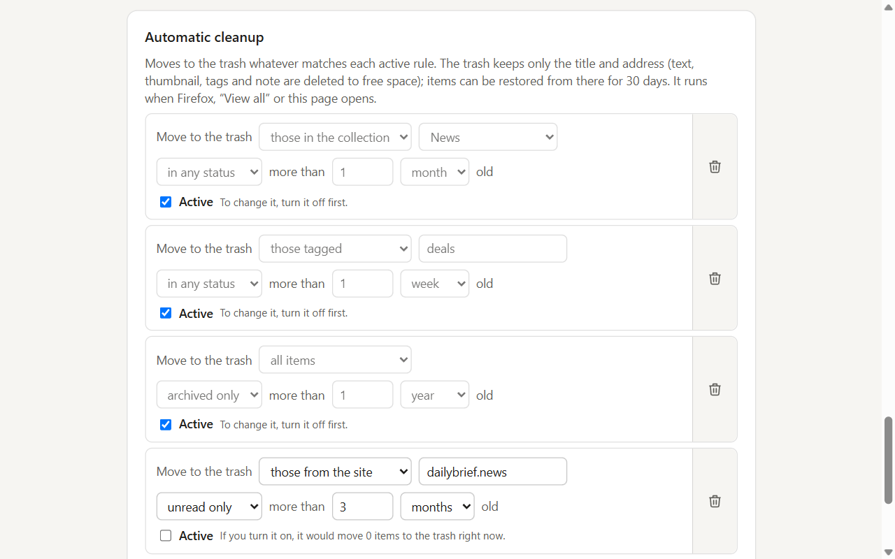
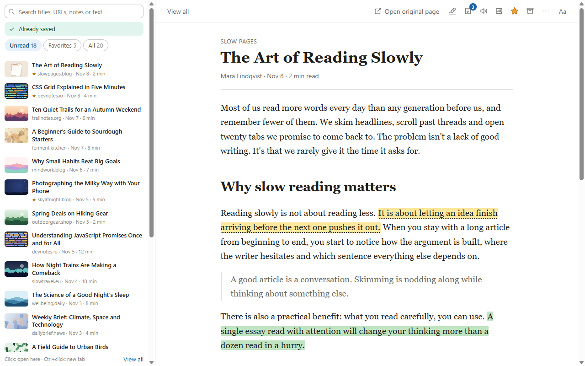
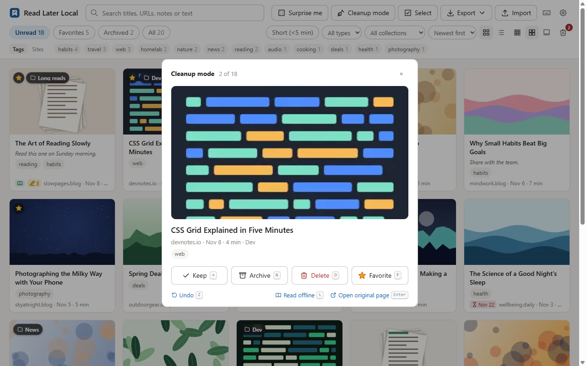

# Read Later Local

A read-it-later extension for Firefox that keeps everything on your computer: no account, no server.
Save pages, read them offline, highlight, listen to them, and keep your list under control with automatic
cleanup rules. A local alternative to Pocket, with import and export of Pocket's CSV.

[Leer en español](README.es.md)



## Features

**Save**
- One click on the address-bar icon (`Alt+Shift+S`), from the toolbar button's menu, or right-click any link or page.
- Several tabs at once, or "Save and close the tab".
- Keeps the article text (with Mozilla's Readability), a thumbnail and, optionally, the article's pictures.
- Recognises the same page under a different address (tracking parameters, `www.`, anchors…).
- Imports a Pocket export (CSV) with tags and archive; imported items are completed in the background.

**Read**
- Offline reader with light, dark and sepia themes, text size, font and column width.
- Remembers where you left off and can archive an article when you reach the end.
- Listen to articles with the voices installed in your system.
- Highlights in four colours with notes; print or save as PDF; send by email; export to Markdown (Obsidian).
- Full-text search across all saved articles.

**Organise**
- Unread, favourites, archive and a 30-day trash.
- Tags, collections, filters by site and type, short reads, bulk editing.
- Automatic rules (for example, `youtube.com` → tag "video").
- Automatic cleanup rules ("items in the News collection older than a month", "archived items older than a year")
  and per-item expiry dates.
- Cleanup mode to go through the list one item at a time, and a sidebar (`Alt+Shift+B`).

**Your data**
- Automatic backups to your Downloads folder; full backup, Pocket-compatible CSV, HTML bookmarks and Markdown exports.
- Collects and sends no data. It only connects to the pages you save.
- 15 languages (including right-to-left Arabic).

| | |
|---|---|
|  |  |
|  |  |

## Install

From Firefox Add-ons: <https://addons.mozilla.org/firefox/addon/read-later-local/>

Requires Firefox 140 or later (desktop).

## Permissions

| Permission | Why |
|---|---|
| `activeTab`, `scripting` | Read the article of the tab you save, only when you ask. |
| `tabs` | Show in the address bar whether the current page is already saved; save several tabs. |
| `menus` | Right-click entries. |
| `storage`, `unlimitedStorage` | Saved articles, thumbnails and optional offline pictures, kept locally. |
| `downloads` | Backups and exports to your disk. |
| `<all_urls>` (optional) | Only if you turn on background download of imported items or offline pictures. It can be removed at any time. |

## Development

```bash
npm install
npm test        # unit tests (node:test, fake-indexeddb, linkedom)
npm run lint    # web-ext lint
npm start       # runs Firefox with the extension (web-ext run)
npm run build   # creates dist/read_later_local-<version>.zip
```

### Preview in a normal browser

`dev/` contains a mock of the WebExtension API, so the pages can be opened in any browser:

```bash
python -m http.server 8765
```

Then open, for example:

- `http://localhost:8765/dev/preview.html?page=list&lang=en&demo=reset` — list with demo data
- `http://localhost:8765/dev/preview.html?page=options&lang=en` — settings
- `http://localhost:8765/dev/preview.html?page=reader&lang=en&id=1` — reader

`dev/demo.js` creates the demo data used for the screenshots (invented articles and illustrations),
`dev/stage.html` lays out the popup and the sidebar for screenshots, and `dev/bench.mjs` times the main
database operations (`node dev/bench.mjs 2000`).

### Structure

```
src/
  manifest.json
  background.js       menus, counter, address-bar icon, saving, backups, cleanup
  popup/              toolbar and address-bar popups
  list/               "View all": filters, search, selection, cleanup mode
  reader/             offline reader, highlights, reading position, text-to-speech
  options/            data and backups, rules, cleanup, appearance, language
  sidebar/            sidebar
  lib/                database (IndexedDB), import/export, article extraction, rules, i18n…
  vendor/             Mozilla Readability 0.6.0 (Apache-2.0), unmodified
  _locales/           15 languages
tests/                unit tests
dev/                  preview, demo data, screenshots, benchmark
docs/screenshots/     screenshots used in this README
```

## License

[Mozilla Public License 2.0](LICENSE). `src/vendor/Readability.js` is © Mozilla, Apache License 2.0
(see `src/vendor/Readability-LICENSE.md`).
